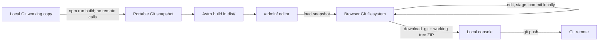

# Astro CMS design

**Status:** Proposed MVP design  
**Decision:** Embed a portable copy of the current local Git repository in the static build. The browser edits and commits locally, downloads the updated repository, and the owner pushes from the console.

## 1. Architecture at a glance



The browser contains a real local Git repository, not a mock working-tree map. It has no remote transport in the MVP. This removes the separate “apply files to a clone” step and preserves browser-created commits for the terminal push.

## 2. Build-time repository snapshot

Add a local Node build step, for example `scripts/embed-repository.mjs`, before `astro build`. It reads the current checkout and never contacts a Git remote.

The package must contain both the working tree and the Git data required for native Git and the browser Git library: object database, refs, current branch/HEAD, index, and safe repository configuration. A `.git` folder alone is insufficient because it does not contain the checked-out source files.

Recommended build procedure:

1. Require a normal, non-bare clone on a named branch with full history. Before building, require a clean source tree; generated `dist/` output and the generated archive are excluded from this check.
2. Build the source tree from committed `HEAD` (for example with `git archive HEAD`) and pair it with the `.git` data for that same repository state. Do not copy uncommitted or untracked source files.
3. Exclude generated output (`dist/`), `.astro`, `node_modules`, the snapshot archive itself, and other build caches.
4. Sanitize Git-local state: remove hooks, reflogs, credential helpers, credential-bearing remote URLs, worktree pointers, and object alternates. Preserve a credential-free `origin` URL when safe. Fail clearly if the source uses unsupported layout/features rather than emit a broken repo.
5. Package the staging working copy as `public/admin/repository.zip` and include metadata (schema version, base SHA, branch, build time, and file hashes). Astro copies it to `dist/admin/repository.zip`.

Use a small cross-platform ZIP library such as `fflate` for build-time packaging and browser-side extraction/repackaging. The build must filter the configured output directory even if it is tracked; otherwise a subsequent build could embed the prior site and grow recursively.

The browser loads this archive into a persistent browser filesystem. Use `isomorphic-git` with a browser-backed filesystem such as LightningFS/IndexedDB, and keep Git work off the UI thread. The local Git dependency set is `isomorphic-git`, a browser filesystem adapter, and a ZIP library such as `fflate`; no browser HTTP Git plugin is needed.

Include the `.git` data required for local commits and console push, but do not copy workstation-specific state verbatim. The normal staging copy preserves reachable history and refs while omitting hooks and credential material. Keep the build clean-tree requirement; it ensures the embedded index and source tree agree at `HEAD`.

## 3. Content files and Astro rendering

The current starter has no content model. Store menu configuration as standalone YAML under `src/data/menus/`, and use Astro content collections for Markdown blog posts and generic pages. Define a `menus` collection with Astro’s `glob()` loader rooted at `src/data/menus` to parse and validate those YAML files. Astro’s loader supports YAML, and collections are data until a page route explicitly renders them ([Content Collections guide](https://docs.astro.build/en/guides/content-collections/)).

Proposed layout:

```text
src/
├── components/
│   └── SiteHeader.astro
├── content.config.ts
├── content/
│   ├── blog/
│   │   └── <slug>.md
│   └── pages/
│       └── <slug>.md
└── data/
    └── menus/
        └── main.yaml
```

Example `src/data/menus/main.yaml`:

```yaml
title: Main navigation
items:
  - label: Home
    href: /
  - label: Journal
    href: /journal/
```

The menu YAML file has no URL of its own; its `items` contain link destinations. `SiteHeader.astro` is the rendering component and reads the menu data. The admin edits the standalone YAML text; it is not Markdown with frontmatter.

Blog entries use frontmatter such as `title`, `pubDate`, `description`, and `draft`, followed by a Markdown body. Generic pages use a title and optional description plus Markdown. Astro page routes render content entries at build time ([Routing guide](https://docs.astro.build/en/guides/routing/)).

The admin route is `src/pages/admin/index.astro`, producing the reserved `/admin/` route. The `menus` collection is data-only; it does not create a URL unless an Astro page explicitly renders it.

## 4. Browser Git workspace

The admin page is static HTML plus client-side JavaScript; no server adapter, Git proxy, or remote credential flow is needed.

- Load and unpack the embedded repository into browser-backed storage.
- Show Menus, Blog posts, and Content lists from the repository files.
- Edit menu YAML and Markdown/frontmatter with a plain text editor. No forms or WYSIWYG in v1.
- Saving writes the browser’s working tree. `git.status` shows modifications; new content files are created in the corresponding path.
- Commit locally using `git.add` and `git.commit`. Collect commit message and author name/email in the UI; multiple commits are supported. No remote requests are made.
- Persist the repo and local commits in IndexedDB so a reload does not reset the branch. Show a clear export/backup reminder because browser storage can be cleared or evicted.
- “Download repository” zips the current working tree and `.git` state, including local commit objects and refs.

The initial UI uses the branch checked out at build time. It does not switch branches or fetch/pull remote changes.

## 5. Console push workflow

Unpacking the downloaded ZIP produces a Git working copy. The owner can run:

```sh
git status
git log --oneline -5
git push origin <current-branch>
```

The archive must preserve a valid, credential-free `origin` URL or explain how to add one. Authentication comes from the console’s existing Git credential helper or SSH key, never from the browser archive. The browser does not commit or push to the remote; it only creates local commits.

If the remote branch advanced since the embedded snapshot, native Git may reject the push. The owner resolves that in the console; the MVP does not fetch, rebase, merge, or resolve conflicts in the browser. No force-push.

## 6. Public-history risk

The Git archive is a public static asset. Anyone who can access the site can download all included reachable history, not merely the current files. Deleted secrets remain in older Git objects. The `/admin/` path and client-side UI do not protect the archive.

Before public deployment:

- review all branches/refs and reachable history for credentials or private content;
- strip credential-bearing URLs, credential helpers, hooks, and machine-local config;
- do not embed `.git` from a private repository or one whose history is not safe to disclose.

Encryption is only a future privacy feature if the decryption key is supplied out-of-band. A key shipped in the static JavaScript is public too.

## 7. Static path behavior

The default `npm run build` target is ignored `dist/`, served from its root; it must remain usable with `cd dist && python3 -m http.server`. Do not hard-code `/astrocms` into the default build.

The GitHub Pages project site is hosted under `/astrocms/`, which normally requires Astro’s deployment `base` to be `/astrocms`. In Astro 7.4.8, tests of `base: './'` and `vite: { base: './' }` still emitted root-absolute `/_astro/...` URLs. Therefore do not assume one output is path-agnostic.

Use the same build command in GitHub Actions with `ASTRO_BASE=/astrocms`; upload `dist/` as the Pages artifact. Configure Pages to use GitHub Actions, and do not commit generated output to the source branch. Set checkout `fetch-depth: 0` so the embedded Git snapshot has the required history. Use `import.meta.env.BASE_URL` for authored public asset references.

## 8. Implementation order

1. Publish the `dist/` artifact with GitHub Pages Actions and ignore the generated repository archive.
2. Define YAML menu data and Markdown collections; migrate menu rendering to read the YAML data.
3. Add the build-time portable Git snapshot, clean-tree check, sanitizer, and public-history warning.
4. Add `/admin/` with an isomorphic-git working tree, browser persistence, text editor, local status, and commit UI.
5. Add full-repository ZIP download and verify the downloaded repo with native Git; verify root and `/astrocms/` deployments.

## 9. Deferred capabilities

- Remote fetch/pull/push from the browser and GitHub REST API push.
- Branch switching, multi-user access, authentication, browser conflict resolution, and force-push.
- WYSIWYG editing, rich blocks, Astro component/code editing, and previewing unpublished content through a real Astro runtime.
- Encryption, until a passphrase/key can be supplied out-of-band and the static-hosting model is reevaluated.