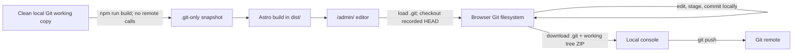

# Astro CMS design

**Status:** MVP implementation complete; verification passed
**Decision:** Embed a `.git`-only snapshot of the current local repository in the static build. The browser checks out `HEAD`, edits and commits locally, downloads the full working repository, and the owner pushes from the console.

## 1. Architecture at a glance



The browser contains a real local Git working repository, not a mock working-tree map. The initial static snapshot contains Git metadata and objects only; browser checkout materializes the files. There is no remote transport in the MVP. Export preserves browser-created commits for the terminal push.


## 2. Build-time Git snapshot

Add a local Node build step, for example `scripts/embed-repository.mjs`, before `astro build`. It reads the current checkout and never contacts a Git remote.

The build archive contains the local `.git` directory only; the working tree is not duplicated. Git objects contain the committed file contents, and `HEAD` plus the current branch identify which tree the browser must materialize. Require a clean worktree so the snapshot cannot silently omit edits.

Recommended build procedure:

1. Require a normal, non-bare clone on a named branch with full history. Before building, require a clean source tree; ignored generated `dist/` output, `base-git.zip`, and the snapshot sidecar are not source changes.
2. Package the repository’s `.git` directory as `public/admin/base-git.zip` with metadata (schema version, base SHA, branch, and build time). Write the same metadata to `public/admin/snapshot.json` so the browser can detect a newer base without downloading the archive. Do not copy the worktree into the initial ZIP.
3. Ensure the snapshot is self-contained and supported by the browser Git library: include the object database, refs, `HEAD`, index, and repository config needed for local checkout and commits. Reject linked worktrees, object alternates, shallow history, submodules, Git LFS, and other unsupported layouts rather than emit a partial repository.
4. Require generated output (`dist/`), `.astro`, `node_modules`, `public/admin/base-git.zip`, and `public/admin/snapshot.json` to be ignored and untracked at `HEAD`; fail if they are tracked. Because the snapshot preserves full history, older commits may still contain such files.
5. Astro copies both generated assets to `dist/admin/`. The default local build and the `/astrocms/` Pages build must reference them through the configured base path.

Use a small cross-platform ZIP library such as `fflate` for build-time packaging and browser-side extraction/repackaging. Since the initial archive preserves `.git` history, verify generated output is untracked at `HEAD`; do not claim to remove files from historical Git objects.

On first initialization in an empty persistent browser filesystem, fetch the small snapshot sidecar, fetch and unpack `.git` from `base-git.zip`, open it with `isomorphic-git`, and force-checkout the recorded branch at `HEAD` to create the working tree. Record that initialization completed; subsequent page loads reuse saved state, compare its base SHA with the sidecar, and warn on staleness without overwriting local edits. Use a browser-backed filesystem such as LightningFS/IndexedDB, flush mutations before acknowledging them, and keep Git work off the UI thread. The dependency set is `isomorphic-git`, `@isomorphic-git/lightning-fs`, `fflate`, and the `buffer` browser polyfill; Vite aliases `buffer` to `buffer/` and `global` to `globalThis` for Worker compatibility. No browser HTTP Git plugin is needed.

The final download is different from the initial snapshot: it contains the browser’s complete working tree and `.git` state, including new commits. The owner can unpack it as a normal working copy and use native Git. Keep the clean-tree build requirement so the embedded index, `HEAD`, and checkout are consistent.

## 3. Content files and Astro rendering

The current starter has no content model. Store menu configuration as standalone YAML under `src/data/menus/`, and use Astro content collections for Markdown blog posts and generic pages. Define a `menus` collection with Astro’s `glob()` loader rooted at `src/data/menus` to parse and validate those YAML files. Astro’s loader supports YAML, and collections are data until a page route explicitly renders them ([Content Collections guide](https://docs.astro.build/en/guides/content-collections/)).

Proposed layout:

```text
src/
├── components/
│   └── SiteHeader.astro
├── content.config.ts
├── content/
│   ├── blog/
│   │   └── <slug>.md
│   └── pages/
│       └── <slug>.md
└── data/
    └── menus/
        └── main.yaml
```

Example `src/data/menus/main.yaml`:

```yaml
title: Main navigation
items:
  - label: Home
    href: /
  - label: Journal
    href: /journal/
```

The menu YAML file has no URL of its own; its `items` contain link destinations. `SiteHeader.astro` is the rendering component and reads the menu data. The admin edits the standalone YAML text; it is not Markdown with frontmatter.

Blog entries use frontmatter such as `title`, `pubDate`, `description`, and `draft`, followed by a Markdown body. Generic pages use a title and optional description plus Markdown. Astro page routes render content entries at build time ([Routing guide](https://docs.astro.build/en/guides/routing/)).

The admin route is `src/pages/admin/index.astro`, producing the reserved `/admin/` route. The `menus` collection is data-only; it does not create a URL unless an Astro page explicitly renders it.

## 4. Browser Git workspace

The admin page is static HTML plus client-side JavaScript; no server adapter, Git proxy, or remote credential flow is needed.

- Load and unpack the embedded `.git` snapshot into browser-backed storage, then checkout the recorded branch at `HEAD` to materialize the source files.
- Show Menus, Blog posts, and Content lists as focused views, plus a Files view covering all checked-out repository paths.
- Edit menu YAML and Markdown/frontmatter with a plain text editor; also edit other text files, including code and configuration.
- Preview common image formats; upload/replace and download binary assets.
- Create, rename, move, and delete files through explicit actions; deletion requires confirmation. Saving writes changes into the browser’s working tree.
- Use `git.status`/status matrix to show modified, untracked, and deleted files. New content files use their collection paths, while Files can create anywhere in the repository.
- Commit locally using `git.add` and `git.commit`. Collect commit message and author name/email in the UI; multiple commits are supported. No remote requests are made.
- Persist the repo and local commits in IndexedDB so a reload does not reset the branch. Show a clear export/backup reminder because browser storage can be cleared or evicted.
- “Download repository” zips the current working tree and `.git` state, including local commit objects and refs.

The initial UI uses the branch checked out at build time. It does not switch branches or fetch/pull remote changes.

## 5. Console push workflow

Unpacking the downloaded ZIP produces a Git working copy. The owner can run:

```sh
git status
git log --oneline -5
git push origin <current-branch>
```

The export preserves the repository configuration from the `.git` snapshot. The owner pushes from the console using their normal Git setup; the browser never uses remote configuration or credentials.

If the remote branch advanced since the embedded snapshot, native Git may reject the push. The owner resolves that in the console; the MVP does not fetch, rebase, merge, or resolve conflicts in the browser. No force-push.

## 6. Public snapshot decision

The initial `.git` archive is a public static asset and contains the included repository history and refs, not just files rendered by the site. Browser checkout materializes only the current `HEAD` as a working tree; older repository data remains in Git. This is an accepted MVP tradeoff, and `/admin/` is not private. The user has deferred password protection and other archive filtering for later.

No encryption or authentication gate is included in this design. Authentication cannot be implemented by a static route alone, and encryption is not meaningful when its decryption key ships in the same static site. Browser operations remain local and use no remote credentials.

## 7. Static path behavior

The default `npm run build` target is ignored `dist/`, served from its root; it must remain usable with `cd dist && python3 -m http.server`. Do not hard-code `/astrocms` into the default build.

The GitHub Pages project site is hosted under `/astrocms/`, which normally requires Astro’s deployment `base` to be `/astrocms`. In Astro 7.4.8, tests of `base: './'` and `vite: { base: './' }` still emitted root-absolute `/_astro/...` URLs. Therefore do not assume one output is path-agnostic.

Use the same build command in GitHub Actions with `ASTRO_BASE=/astrocms`; upload `dist/` as the Pages artifact. Configure Pages to use GitHub Actions, and do not commit generated output to the source branch. Set checkout `fetch-depth: 0` so the embedded Git snapshot has the required history. Use `import.meta.env.BASE_URL` for authored public asset references.

## 8. Implementation order

1. Publish the `dist/` artifact with GitHub Pages Actions and ignore the generated `.git` snapshot archive.
2. Define YAML menu data and Markdown collections; migrate menu rendering to read the YAML data.
3. Add the build-time `.git`-only snapshot, clean-tree check, and browser-compatible repository validation.
4. Add `/admin/` with browser checkout of `HEAD`, an isomorphic-git working tree, persistence, full-repository text editing and asset operations, local status, and commit UI.
5. Add full working-repository ZIP download and verify the downloaded repo with native Git; verify root and `/astrocms/` deployments.

## 9. Deferred capabilities

- Remote fetch/pull/push from the browser and GitHub REST API push.
- Branch switching, multi-user access, authentication, browser conflict resolution, and force-push.
- WYSIWYG editing, rich blocks, and previewing unpublished content through a real Astro runtime.
- Encryption, until a passphrase/key can be supplied out-of-band and the static-hosting model is reevaluated.